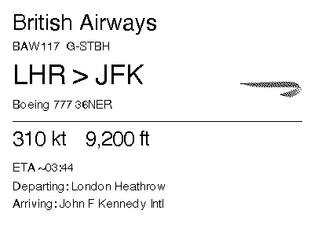
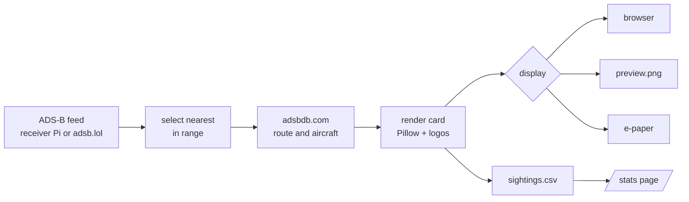

# flighttracker

Shows the aircraft currently overhead on a small e-paper display, using a local ADS-B receiver
(RTL-SDR dongle on a Raspberry Pi running readsb/dump1090/tar1090) for live positions and
adsbdb.com for route and aircraft details.



## Why I built it

My son loves planes and is glued to Flightradar24, so I built him a little screen for the shelf that
shows what's flying over our house right now: the airline, the route, the aircraft type, how high and
how fast. It sits in the corner and updates by itself, so he can look up when he hears an engine and
know what it is.

## Try it in 30 seconds

No receiver, hardware or location needed:

```
python3 -m venv .venv && source .venv/bin/activate
pip install -r requirements.txt
python -m flighttracker.main --demo      # open http://localhost:8000
```

## Run it for real

```
cp .env.example .env     # then set HOME_LAT and HOME_LON
python -m flighttracker.main
```

Open http://localhost:8000 and the card refreshes itself. `--display preview` writes `preview.png`
instead; add `--once` for a single frame.

By default it reads the public [adsb.lol](https://adsb.lol) feed around your location. To use your own
receiver, set `AIRCRAFT_URL=http://<your-pi>/tar1090/data/aircraft.json` in `.env` (use the real address,
without the angle brackets). Settings can also be exported as environment variables, which win over `.env`.

Optional: `RADIUS_KM` (25), `MIN_ALTITUDE_FT` (500), `POLL_SECONDS` (20).

## How it works



One small loop in `main.py`: poll the feed, keep the nearest aircraft (sticking with it while it's in range
so the card doesn't flicker between two planes), look up its route, draw a 1-bit card, and redraw the
screen only when the card changes. If the feed is down the card says so and recovers on its own.

## Photos, speed and ETA

- **Photos:** the card shows a photo of the aircraft when [Planespotters.net](https://www.planespotters.net)
  has one. Photos are cached in `photos/` (git-ignored; they
  aren't part of the repo). Set `SHOW_PHOTOS=0` to turn them off.
- **Speed and altitude** are in knots and feet, as on a flight deck.
- **ETA** is an estimate: the straight-line distance to the destination at the plane's current speed.
  It ignores the route flown, wind and the slowdown on approach, so it's best on short flights. The
  free data sources don't include take-off times, so the card doesn't show one.

## Stats

Every flight shown is logged to `sightings.csv`. See what flies over you at http://localhost:8000/stats,
or run `python -m flighttracker.stats` for a text summary.

## On the display Pi

Install the Waveshare `waveshare_epd` library, then run with `--display epaper`. To start it at boot,
use [deploy/flighttracker.service](deploy/flighttracker.service) (instructions at the top of the file).

## Tests

```
python -m unittest discover -s tests
```

They run offline, and GitHub Actions runs them on every push.

## What I'd do next

- **Show more than one aircraft** when several are overhead, such as the nearest plus a short "also
  nearby" list, instead of picking one.
- **Unit options:** a setting to switch between feet/knots and metres/km/h.
- **Take-off time and a better ETA** from a flight-schedule API (these are paid or need a key).
- **Better demo and stats:** a replay of a real day from `sightings.csv`, and charts in `/stats`.
- **Packaging:** a `pyproject.toml` so it installs with `pip install .` and has a `flighttracker` command.
- **Alerts:** highlight rare types (A380, military, vintage) in the log.

## Airline logos

Logos are fetched automatically by airline ICAO code from
[Jxck-S/airline-logos](https://github.com/Jxck-S/airline-logos) and cached in `logos/`
(git-ignored, as they are trademarks). To use your own, save `logos/<ICAO>.png` (e.g. `TOM.png`).

Logos are dithered by default. For solid logos set `LOGO_THRESHOLD` (1-254, e.g. `128`): pixels
darker than the value become black, the rest white, giving crisp edges. Use `0` to dither.

## Night mode, errors and the sightings log

- **Night mode:** between `NIGHT_START` (default 23) and `NIGHT_END` (default 7) the display shows
  a near-blank card and stops polling. Set both to the same value to turn it off.
- **Receiver unreachable:** if the feed can't be read, the display says so (instead of looking
  like a quiet sky) and recovers by itself.
- **Flights with no route** (private and light aircraft) show the aircraft type from the receiver's
  data instead of `??? > ???`.
- **Sightings log:** every flight shown is appended to `sightings.csv` (git-ignored); see Stats above.

On a Raspberry Pi, set the time zone first (`sudo raspi-config` > Localisation > Timezone), or the
clock and night mode will follow UTC.
